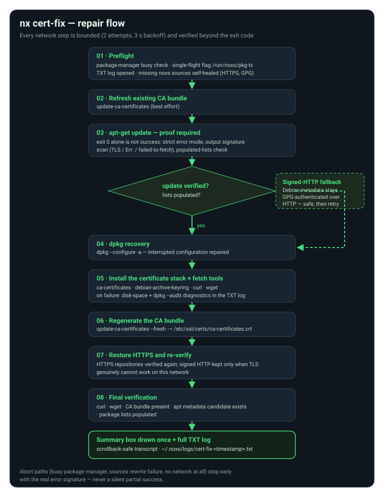

# Certificates & APT repair — `nx cert-fix`



## Why it exists

The shipped Debian 12 rootfs is a **minimal base**: it does not include
`curl`, `wget` or the `ca-certificates` bundle, and the app-side APT
bootstrap (`NoxsAptBootstrapper`) only runs from the Android side during
setup. When that bootstrap never completed — failed network, an older app
version, a cancelled setup — the guest ends up with empty package lists
and no repair path. The classic symptom is instant, misleading failure:

```console
$ sudo apt install curl
E: Unable to locate package curl
```

`nx cert-fix` repairs the whole APT package layer **from inside the
shell** — no app reinstall, no environment reset. It is part of the
[NX Package System](PACKAGES.md) and is installed into
`/usr/local/lib/noxs-pkg` by the `RootfsConfigurator` alongside the other
`nx` commands.

!!! tip "When to run it"

    Run `nx cert-fix` when `apt` cannot find packages ("Unable to locate
    package ..."), when downloads fail with certificate or TLS errors,
    when `/etc/apt/sources.list.d/noxs.sources` is missing or truncated,
    or after a setup that kept failing at the APT stage.

## What it does

The repair mirrors the app-side bootstrap policy and runs as a single
bounded sequence:

1. **Refresh the already-installed CA bundle** (best effort — skipped
   when `update-ca-certificates` is not installed yet).
2. **`apt-get update` with proof of success.** The exit code alone is
   never trusted: apt exits `0` in warn mode even when index downloads
   failed. A real success requires *all* of — exit 0, no failure
   signatures (`Err:`, TLS handshake, `certificate verification failed`,
   `failed to fetch`, ...) in the captured output, and populated package
   lists after the run.
3. **Signed-HTTP fallback.** If the HTTPS transport fails the proof
   check, the repository URIs are temporarily rewritten to plain HTTP.
   This is safe because Debian repository metadata stays
   GPG-authenticated (`Signed-By: debian-archive-keyring`) regardless of
   transport — unauthenticated packages are still rejected by apt.
4. **dpkg recovery** — `dpkg --configure -a` for interrupted package
   configuration.
5. **Install the certificate stack and fetch tools** —
   `ca-certificates`, `debian-archive-keyring`, `curl`, `wget`
   (non-interactive, `--no-install-recommends`). On failure the log
   collects disk-space (`df -h /`) and `dpkg --audit` diagnostics.
6. **Regenerate the CA bundle** — `update-ca-certificates --fresh`.
7. **Restore HTTPS and re-verify.** Signed HTTP is kept only when TLS
   genuinely cannot work on this network — never as a silent downgrade.
8. **Final verification** — `curl` and `wget` binaries, the CA bundle
   file, an `apt-cache policy` candidate for `ca-certificates`, and
   populated package lists. Any miss marks the run as failed.

## Usage

```console
$ nx cert-fix
```

The command takes no arguments (`nx cert-fix --help` prints the
reference). It must run inside the Noxs Linux environment — from the
terminal, or from any session — with either root or `sudo` available
(it escalates via `sudo` automatically).

## Safety model

The repair follows the same rules as every other package operation in
Noxs:

- **Single-flight package policy.** `/run/noxs/pkg-tx` plus running
  `dpkg`/`apt` processes are checked before any apt run, and the flag is
  armed for the duration of the repair. Concurrent package managers
  refuse to start rather than corrupt the dpkg database.
- **Bounded network steps.** Every network command gets 2 attempts with
  a 3-second backoff, and two *identical* failures in a row abort the
  retry loop — the same failure cannot burn retries forever.
- **Honest exit codes.** The command returns non-zero if any final
  verification fails; it never reports success on a partial repair.
- **Shell wrappers respected.** The script calls `/usr/bin/apt-get`
  directly with the same busy checks as the user-facing apt wrappers —
  it does not bypass the package system guards.
- **A missing `noxs.sources` is self-healed** from the canonical
  definition (HTTPS, GPG-signed, byte-identical to the app-side
  `RootfsConfigurator.aptSources`) instead of aborting the repair.

## Output and logs

Terminal output is a plain, scrollback-safe transcript — every line
stays in the scrollback and remains copy-paste friendly — plus **one**
summary box drawn once at the end. No cursor save/restore redraws: those
garble when the terminal view scrolls during a multi-line redraw. A full
TXT log keeps the run auditable at:

```text
~/.noxs/logs/cert-fix-<timestamp>.txt
```

The summary box carries the last log lines and the path to the full log,
so a failed repair always tells you where to look next.

## Related

- [Bootstrap system](BOOTSTRAP.md) — how the environment is installed
  and why the first-run APT bootstrap exists.
- [NX Package System](PACKAGES.md) — the `nx` CLI, official packages
  and `.nx.pkg` artifacts that this repair unblocks.
- [Security model](SECURITY.md) — why sudo and the sandbox boundary
  stay intact during any repair.
