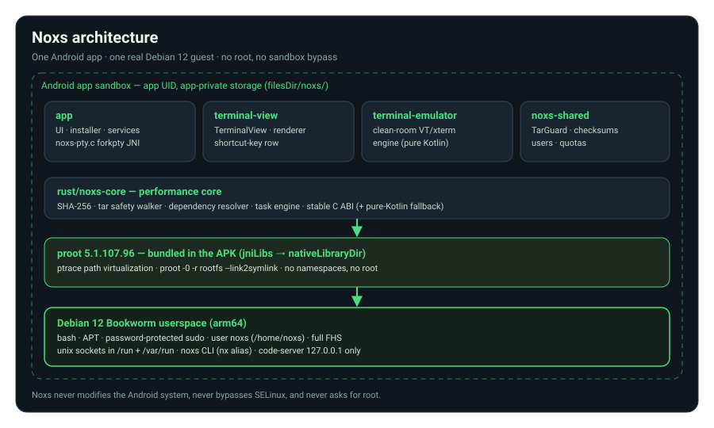

# Noxs — a small Linux computer in your pocket

<div class="hero" markdown>

**A Debian-optimized Linux environment for Android.** Noxs runs a real
**Debian 12 (Bookworm)** userspace — bash, APT, sudo, Unix domain sockets
under `/run` and `/var/run`, user accounts, services and the full Linux
filesystem hierarchy — inside the Android application sandbox, using
**proot**. No root required, no security bypass, ARM64-first.

</div>

```console
$ whoami
noxs
$ pwd
/home/noxs
$ sudo apt install git
$ noxs code start
code-server is running at http://127.0.0.1:8080
```

## Why Noxs

<div class="grid cards" markdown>

- :material-debian:{ .lg .middle } __Real Debian 12 userspace__

    ---

    Official Debian 12 (Bookworm) rootfs with APT, glibc binaries and real
    Debian sudo — nothing recompiled against bionic. Every command works
    offline after bootstrap.

    [:arrow-right: Architecture](ARCHITECTURE.md)

- :material-console:{ .lg .middle } __A real terminal__

    ---

    PTY (native `forkpty`), a clean-room VT/xterm engine, colors, Unicode,
    scrollback, resize, pinch-to-zoom, full-document search, multiple
    sessions and an honest full-screen mode.

    [:arrow-right: Terminal UX](TERMINAL-UX.md)

- :material-folder-open:{ .lg .middle } __True FHS filesystem__

    ---

    `/bin` `/etc` `/home/noxs` `/run` `/var/run` `/var/log` — the layout
    Linux software expects. Password-protected sudo, scoped to the Noxs
    sandbox. Never Android root.

    [:arrow-right: Security model](SECURITY.md)

- :material-plug:{ .lg .middle } __Unix domain sockets__

    ---

    `unix:///var/run/noxs/…` plus Android↔Debian IPC — daemons, services
    and IPC just work, because the paths exist for real.

    [:arrow-right: Unix sockets](UNIX-SOCKETS.md)

- :material-code-braces:{ .lg .middle } __VS Code in your pocket__

    ---

    The built-in editor is real code-server (VS Code in the browser),
    bound to `127.0.0.1` only, with a workspace that follows your active
    terminal session via OSC 7.

    [:arrow-right: Editor](CODE-SERVER.md)

- :material-package-variant:{ .lg .middle } __NX Package System__

    ---

    `nx pkg init` scaffolds Node.js / Rust / C++ / Python / Go projects
    with automatic GitHub Actions releases, versioned `.nx.pkg` artifacts
    and sha256-verified multi-arch builds.

    [:arrow-right: Packages](PACKAGES.md)

- :material-robot:{ .lg .middle } __AI Agent Terminal__

    ---

    `nx ai` opens an interactive `nx@ai>` agent that plans multi-tool work
    across terminal, files, packages, processes and services — asking
    `Allow? [y/N]` for sensitive actions.

    [:arrow-right: AI Agent](AI-AGENT.md)

- :material-globe-model:{ .lg .middle } __Native browser__

    ---

    `nx ow https://example.com` opens a real `android.webkit.WebView` in a
    draggable floating window with URL validation, cookies and downloads —
    zero bridge exposure.

    [:arrow-right: Browser](WEB-BROWSER.md)

- :material-puzzle:{ .lg .middle } __API & plugins__

    ---

    The `@noxs/nx-api` SDK and Plugin SDK sit behind the Permission Center:
    packages are isolated, requests are validated and every grant is
    visible.

    [:arrow-right: Permission Center](PERMISSION-CENTER.md)

- :material-speedometer:{ .lg .middle } __Rust performance core__

    ---

    The `noxs-core` crate (SHA-256 verification, tar safety walker,
    dependency resolver, task engine) with a stable C ABI and a pure-Kotlin
    fallback.

    [:arrow-right: Rust core](RUST-CORE.md)

</div>



## Getting started

1. Download the latest release installer from
   [GitHub Releases](https://github.com/crossberry-in/noxs/releases) and
   install the APK on an ARM64 Android device (Android 7.0+).
2. Open Noxs and tap **Set up Linux environment**.
3. Set the `noxs` user password — it is used by `sudo` inside the sandbox.
4. Bootstrap downloads and verifies Debian 12 + proot (SHA-256 pinned,
   ARM64 prioritized).
5. The terminal opens at `noxs@android:~$` — everything after bootstrap
   works offline.

## Building from source

Requirements: JDK 17, Android SDK (platform 34), NDK 26.3, CMake 3.22.1.

```bash
scripts/bootstrap.sh          # verify toolchain, provision wrapper
./gradlew assembleDebug       # → app/build/outputs/apk/debug/app-debug.apk
./gradlew testDebugUnitTest   # JVM tests (security core, VT engine, launcher)
scripts/test.sh               # full validation incl. manifest + sync checks
```

CI builds everything automatically — see
[Testing & CI](TESTING.md) and
[`.github/workflows/android-ci.yml`](https://github.com/crossberry-in/noxs/blob/main/.github/workflows/android-ci.yml)
in the repository.

## About this site

This documentation is built with
[Material for MkDocs](https://squidfunk.github.io/mkdocs-material/) and
deployed automatically to GitHub Pages on every change to `main`. The
pages under **Guides**, **Architecture & Security**, **Extending Noxs**
and **Development** are the project's engineering documents, kept in the
[`docs/`](https://github.com/crossberry-in/noxs/tree/main/docs) directory
of the repository.
